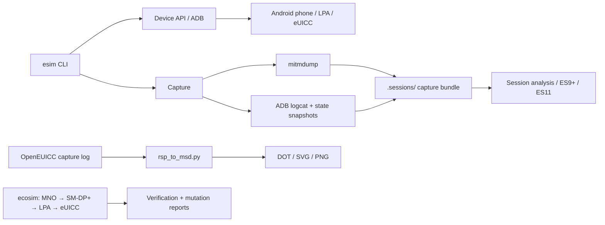
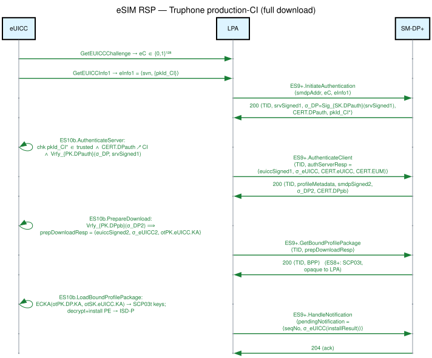

<div align="center">

# eSIM Research Lab

**Inspect Android eSIMs. Trace provisioning. Explore protocol behavior.**

A Python toolkit and experimental testbed for eUICC inspection, Remote SIM
Provisioning (RSP) capture, protocol analysis, and local ecosystem simulation.

[Get started](#get-started) · [Experiments](testbed/README.md) · [Documentation](docs/README.md) · [Contributing](CONTRIBUTING.md)

</div>

## Research capabilities

| Area | What is implemented | Source / guide |
| --- | --- | --- |
| Device inspection | Read eUICC identifiers, list subscriptions, and inspect device state through ADB | [Device API](esim/device.py) |
| Capture and analysis | Record proxy traffic, filtered logcat, and eUICC snapshots; extract ES9+ / ES11 calls and profile packages | [Capture](esim/capture.py) · [Analysis](esim/analysis.py) |
| eUICC control | OpenEUICC-backed commands, APDU transport, and BER-TLV handling | [eUICC module](esim/euicc/README.md) |
| Protocol visualization | Convert OpenEUICC capture logs into Graphviz message sequences | [Diagram pipeline](scripts/msd/README.md) |
| Software simulation | Model MNO → SM-DP+ → LPA → eUICC flows, inspect channels, and mutate messages | [ecosim](testbed/ecosim/README.md) |
| Protocol fuzzing | Explore APDU inputs and local SM-DS responses with separate research harnesses | [Tools](tools/README.md) |
| Modem observation | Capture and decode NAS/RRC attach traces on the documented Pixel 7a setup | [Baseband experiment](testbed/baseband-attach/README.md) |

## Architecture

The core CLI coordinates device access and capture. Offline analysis reads saved
sessions. The simulator and fuzzers have their own entry points and dependencies.



Implementation: [CLI](esim/cli.py), [capture lifecycle](esim/capture.py),
[analysis API](esim/analysis.py), and [simulator driver](testbed/ecosim/testing/run_e2e.py).

## Get started

Use Python **3.12 or newer**. Run these commands from a clone of this repository:

```bash
git clone https://github.com/alirafiqmalik/esim-research-lab.git
cd esim-research-lab
python3 -m venv .venv
source .venv/bin/activate
python -m pip install -e '.[dev]'

esim --help
python -m pytest -q
```

The core tests use mocked device access and local fixtures. They do not require
a connected phone. Experiment-specific suites are documented in their directories.
The editable checkout also supplies the assets needed by `esim gtp analyze`.

### Inspect a device

Install Android platform tools and connect a phone with USB debugging enabled.
Confirm the connection with `adb devices`. Device support and required privileges
vary by operation; see the [eUICC guide](esim/euicc/README.md).

```bash
adb devices
esim --serial DEVICE_SERIAL eid
esim --serial DEVICE_SERIAL profiles list
```

### Capture and analyze provisioning

First configure the device's proxy route and TLS trust using the
[setup scripts](scripts/README.md) and [capture notes](scripts/frida/README.md).
Starting the capture command alone does not route phone traffic through the host
or bypass TLS pinning.

```bash
# Stop with Ctrl-C after the provisioning operation.
esim --serial DEVICE_SERIAL capture --port 8080

# Use the session directory printed by the capture command.
esim analyze .sessions/SESSION_DIRECTORY
```

Each saved session contains:

```text
.sessions/SESSION_DIRECTORY/
├── traffic.mitm       # proxy flows
├── logcat.txt         # filtered Android events
├── euicc_state.json   # start and end snapshots
└── metadata.json      # device and session metadata
```

Use the same analysis implementation from Python:

```python
from esim.analysis import Session

session = Session.load(".sessions/SESSION_DIRECTORY")
for call in session.es9_calls():
    print(call.interface, call.method)

print("ES11 calls:", len(session.es11_calls()))
print("Profile packages:", len(session.bpp_blobs()))
```

## From capture to diagram

This existing Truphone provisioning sequence comes from the repository's RSP
work. Its editable DOT source is kept beside the rendered image.

[](docs/diagrams/rsp-truphone-success.svg)

[Diagram source](docs/diagrams/rsp-truphone-success.dot) ·
[Test-CI rejection example](docs/diagrams/rsp-sysmocom-testci-fail.svg) ·
[Diagram catalog](docs/diagrams/README.md)

With Graphviz installed, render your own OpenEUICC capture log:

```bash
mkdir -p .sessions/figures
bash scripts/msd/render_msd.sh \
  .sessions/SESSION_DIRECTORY/capture.txt \
  .sessions/figures/rsp "RSP capture"
```

The input is an OpenEUICC text log containing `HttpInterfaceImpl` messages.
It is a separate input format from the core CLI's `traffic.mitm` bundle.
The pipeline writes `.dot`, `.svg`, and `.png` files.

## Repository map

```text
esim/                   Reusable Python package and CLI
├── euicc/              eUICC control and TLV helpers
└── gtp/                GSMA TS.48 profile analysis
tests/                  Core offline tests
testbed/                Experiments, simulator, and recorded findings
tools/                  Standalone fuzzing harnesses
scripts/                Setup, device helpers, Frida, and diagram rendering
assets/                 Reference test-profile material
docs/
├── reference/          API and interface maps
├── research/           Protocol research notes
├── testbed/            Evaluation reports and setup notes
├── diagrams/           Diagram sources, images, and templates
├── superpowers/        Implementation plans and specifications
└── archive/            Historical reports
```

See the [repository guide](docs/repository-guide.md) for placement conventions.

## Scope and limitations

- This is a research testbed. Hardware results depend on the phone, Android build,
  LPA, privileges, and network setup recorded in each experiment.
- `ecosim` is a software model with its own protocol choices. Its results do not
  establish GSMA conformance or production eUICC behavior.
- Empty analysis output does not prove that no traffic occurred. The current
  loader returns an empty flow list when a capture cannot be read.
- The root test suite covers the reusable package. It does not certify live
  device workflows or all standalone tools.
- Keep device captures and subscriber data in local session directories.
  Review any material before sharing it.

## Contribute

Start with [CONTRIBUTING.md](CONTRIBUTING.md). Include reproducible commands,
the relevant device or simulator context, and source-backed findings.

No project license has been declared. Third-party test-profile material retains
its upstream terms; inclusion here does not grant redistribution rights.
